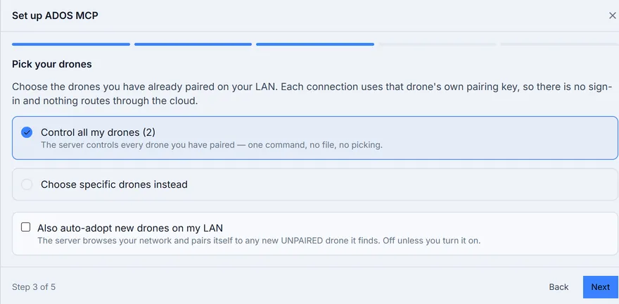
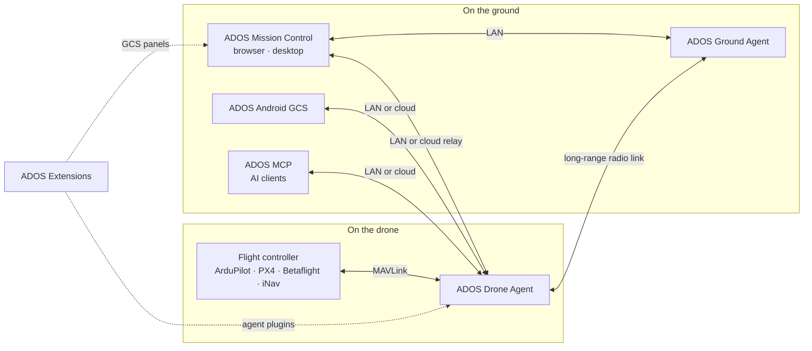

<p align="center">
  <a href="https://altnautica.com">
    <picture>
      <source media="(prefers-color-scheme: dark)" srcset=".github/assets/brand/ados-lockup-dark.svg">
      
    </picture>
  </a>
</p>
<h1 align="center">ADOS MCP</h1>
<p align="center"><em>A Model Context Protocol server for ADOS drones: scoped access, confirmed flight actions, an audit trail on every call.</em></p>
<p align="center">
  <a href="./LICENSE"></a>
  <a href="https://www.typescriptlang.org/"></a>
  <a href="https://modelcontextprotocol.io"></a>
  <a href="#contributing"></a>
  <a href="https://discord.gg/uxbvuD4d5q"></a>
</p>
<p align="center">
  <strong><a href="https://github.com/altnautica/ADOSMissionControl">Mission Control</a></strong> |
  <strong><a href="https://github.com/altnautica/ADOSDroneAgent">Drone Agent</a></strong> |
  <strong><a href="https://github.com/altnautica/ADOSAndroidGCS">Android GCS</a></strong> |
  <strong><a href="https://github.com/altnautica/ADOSExtensions">Extensions</a></strong> |
  <strong><a href="https://github.com/altnautica/ADOS-MCP">MCP</a></strong> |
  <strong><a href="https://github.com/altnautica/ADOSDroneAgent/tree/main/crates#published-crates">Rust crates</a></strong> |
  <strong><a href="https://docs.altnautica.com">Docs</a></strong> |
  <strong><a href="https://altnautica.com">Website</a></strong> |
  <strong><a href="https://discord.gg/uxbvuD4d5q">Discord</a></strong>
</p>
<p align="center">
  <a href="https://docs.altnautica.com/developers/mcp-server">Docs</a> ·
  <a href="https://github.com/altnautica/ADOS-MCP/issues">Issues</a> ·
  <a href="https://modelcontextprotocol.io">Model Context Protocol</a>
</p>

<p align="center">
  <picture>
    <source media="(prefers-color-scheme: dark)" srcset=".github/assets/screens/mcp-wizard-dark.webp">
    
  </picture>
</p>

ADOS MCP lets any MCP-capable AI client connect to an ADOS drone or ground station and read it, administer it, and, when the operator explicitly allows it, fly it. Every connection carries a scope, anything that moves an aircraft needs a confirmation, and every call lands in an audit trail.

## Set it up (Claude Code)

You run the server yourself, from this repo; there is no package to install. The Mission Control MCP tab has a guided wizard that walks you through these steps and fills in your drone's host and pairing key (local) or your credential (cloud).

**Prerequisites:** Node ≥ 20, git, [pnpm](https://pnpm.io) (`npm install -g pnpm`), and an MCP client (e.g. [Claude Code](https://docs.claude.com/claude-code)).

**1. Get and build the server:**

```bash
git clone https://github.com/altnautica/ADOS-MCP.git
cd ADOS-MCP
./scripts/setup.sh          # installs, builds, and prints your exact add command
# (or do it by hand: pnpm install && pnpm build)
```

**2. Add the server to your client.** Start local: reach a drone on your LAN with no login. The pairing key rides in the client's environment (`-e`), not your shell (the wizard fills it in):

```bash
# One drone on the LAN:
claude mcp add ados -e ADOS_MCP_AGENT_KEY=<pairing-key> -- \
  node "$(pwd)/dist/index.js" --target agent <host>

# Your whole LAN fleet in ONE command (the MCP tab's "control all my drones" wizard
# generates this; every drone's host + key rides in the env, no file):
claude mcp add ados -e ADOS_MCP_FLEET=<blob> -- node "$(pwd)/dist/index.js" --target local-fleet
# (or point at a fleet file: --target local-fleet ~/.ados/mcp/fleet.json)
# Add --discover to also auto-adopt new UNPAIRED drones on your LAN.
```

Or, to reach your fleet from anywhere through the cloud (opt-in), mint a credential in the Mission Control MCP tab:

```bash
claude mcp add ados -e ADOS_MCP_TOKEN=<credential> -- \
  node "$(pwd)/dist/index.js" --target fleet --gcs prod
```

The server auto-selects the **stdio** transport when a client launches it, so no `--transport` flag is needed.

**3. Check it works** (optional, before or without a client):

```bash
# Local (a drone on your LAN):
ADOS_MCP_AGENT_KEY=<pairing-key> node dist/index.js --target agent <host> --verify
# → ✓ Connected, agent mode → http://<host>:8080

# Cloud (your fleet from anywhere):
ADOS_MCP_TOKEN=<credential> node dist/index.js --target fleet --gcs prod --verify
```

Then ask your client for a drone's status. See [`docs/`](./docs) for the tool catalog and the full architecture.

## What it does

<table>
  <tr>
    <td width="50%">
      <picture>
        <source media="(prefers-color-scheme: dark)" srcset=".github/assets/screens/mcp-wizard-dark.webp">
        
      </picture>
      <p align="center"><a href="https://docs.altnautica.com/mission-control/mcp">Guided setup in Mission Control</a></p>
    </td>
    <td width="50%">
      <picture>
        <source media="(prefers-color-scheme: dark)" srcset=".github/assets/screens/mcp-dialog-dark.webp">
        
      </picture>
      <p align="center"><a href="https://docs.altnautica.com/developers/mcp-server">Scoped credentials per connection</a></p>
    </td>
  </tr>
</table>

ADOS MCP works with any MCP-capable AI client: Claude Code first-class, plus Claude Desktop, Cursor, VS Code, or a plain HTTP client. Through it you can:

- Read live status, telemetry, and health for a node or a fleet.
- Read every flight-controller parameter with full meaning and get tuning recommendations.
- Administer the platform: rename a node, update the software, install and configure plugins, restart a service, manage pairing and network settings.
- Query logs and a full audit trail.
- Fly, when the operator explicitly grants it: arm, change mode, go to a point, run a mission, land, return home, or stop.

The drone is the server; the AI is the client. No model runs on the drone. The server is a thin layer over interfaces that already exist, so behavior is defined once and stays consistent whether it is reached from the console, the command line, or an AI client.

**Visibility is broad; action is gated.** Reading is open within the granted scope. Writing is controlled by that scope, a safety class per action, a confirmation step for anything that moves an aircraft or changes state, and an operator-present check for flight. Every call, allowed or denied, is recorded.

## How ADOS fits together



ADOS Ground Agent is the Drone Agent running its ground-station profile.

| Repo | Runs on | What it does | Link |
|---|---|---|---|
| ADOS Mission Control | Browser, desktop (Electron) | Ground control station: FC setup, mission planning, flight, 3D simulation, fleet | [ADOSMissionControl](https://github.com/altnautica/ADOSMissionControl) |
| ADOS Drone Agent | Companion computer on the drone, or a ground node | Onboard agent: MAVLink routing, HD video, long-range radio link, plugins, remote control | [ADOSDroneAgent](https://github.com/altnautica/ADOSDroneAgent) |
| ADOS Android GCS | Android phones and tablets | Native ground control app for agents on the LAN, direct flight controllers and the cloud | [ADOSAndroidGCS](https://github.com/altnautica/ADOSAndroidGCS) |
| ADOS Extensions | Drone Agent and Mission Control | First-party signed plugins, each with an agent half and a GCS half | [ADOSExtensions](https://github.com/altnautica/ADOSExtensions) |
| ADOS MCP | Your machine | Model Context Protocol server that lets AI clients operate ADOS drones under scopes and a safety gate | [ADOS-MCP](https://github.com/altnautica/ADOS-MCP) |
| Documentation | docs.altnautica.com | Public docs for every ADOS product | [Documentation](https://github.com/altnautica/Documentation) |

## Ways to run it

You run the server yourself, on your own machine. **Local-first: reach your drones directly over the LAN, with no sign-in and no cloud.** Cloud is an opt-in path for reaching your fleet from anywhere.

| Mode | Command | Reaches | Needs |
|------|---------|---------|-------|
| **Agent** (default) | `--target agent <host>` | one drone on your LAN | the drone's pairing key |
| **Local fleet** | `--target local-fleet` | many drones on your LAN | the fleet in one env var (or a file), each drone's host + key; `--discover` auto-adopts new unpaired drones |
| **Fleet** (cloud, opt-in) | `--target fleet --gcs prod` | your fleet from anywhere, via Mission Control | a Mission Control sign-in + a minted credential |

All three expose the identical tools; only the reach differs.

- **Agent and local-fleet are the local-first paths.** The server talks straight to your drones over the LAN: no cloud round-trip, no login. A drone's own pairing key (stored when you paired it in Mission Control) authorizes the connection. This is the everyday path for a bench, a field setup, or your own network.
- **Fleet-mode is the opt-in "manage from anywhere" path.** It connects to a Mission Control (GCS) backend, either your own local one (`--gcs local`) or the production one (`--gcs prod`), as you, the operator, and reaches the drones Mission Control tracks in the cloud. Useful when you are off the drones' network; it needs a signed-in operator to mint a credential.

## Transports

- **Streamable HTTP** (`POST /mcp`, single endpoint, SSE upgrade for streams), the primary networked transport.
- **stdio**, the local one-liner for Claude Code and Desktop. A LAN target needs no token, and that tokenless principal holds every scope except `flight` and `destructive`: presence on your laptop is not presence on the aircraft. Pass `--token` with a flight-scoped token to reach the flight tools.
- **Unix socket** (`/run/ados/mcp.sock`), on-box in agent and local-fleet modes, where local presence is the credential. It waives the scope check, never the safety gate.

## Safety model

- A token carries scopes (`read`, `safe_write`, `admin`, `flight`, `destructive`, `secret_read`). Flight and destructive are off by default.
- Every write is checked against the token scope, a per-tool safety class, and, for flight or destructive actions, a typed confirmation and an operator-present signal.
- Annotations (`readOnlyHint`, `destructiveHint`) are advertised honestly but are hints, never the enforcement point. The server enforces.
- Every call produces one redacted audit event.
- No principal is trusted past the safety gate, including the on-box one: an admin call still needs its confirmation and a flight call still needs an operator-present signal or a signed confirm.
- `--sim` only opts in to the SITL waiver. The server asks the target whether its flight controller is a simulator and refuses to start if it is not, so the waiver can never be asserted onto real hardware.

## Develop

```bash
pnpm install
pnpm typecheck
pnpm lint
pnpm test
pnpm build
```

The connector is a thin shim, so it holds no telemetry buffers and runs no inference. It calls the platform's existing interfaces and presents them through MCP.

## Community

Questions and show-and-tell go in [Discord](https://discord.gg/uxbvuD4d5q). Bugs and feature requests go in [Issues](https://github.com/altnautica/ADOS-MCP/issues).

## Contributing

Issues and pull requests are welcome. The repository is developed in the open under the MIT license. Please keep contributions technical and free of any private or third-party content.

## License

MIT. See [`LICENSE`](./LICENSE). Built for civilian use.
