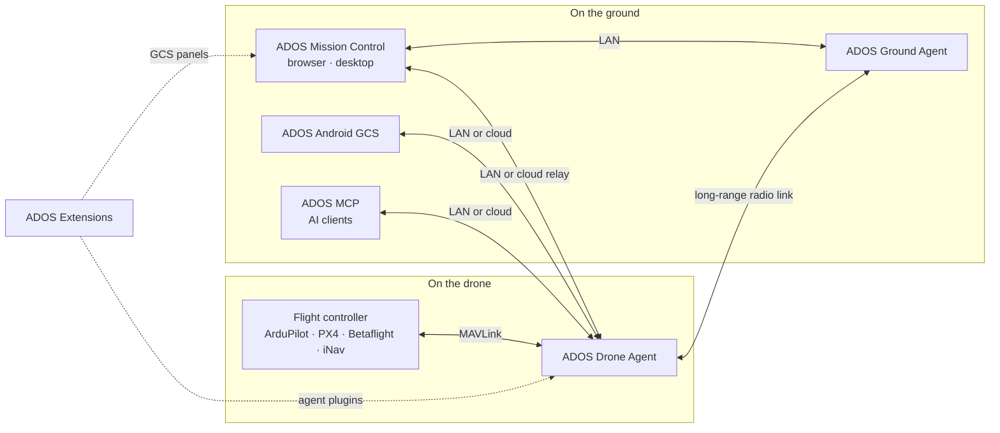

<p align="center">
  <a href="https://altnautica.com">
    <picture>
      <source media="(prefers-color-scheme: dark)" srcset=".github/assets/brand/altnautica-wordmark-dark.svg">
      
    </picture>
  </a>
</p>
<h1 align="center">ADOS MCP</h1>
<p align="center"><em>A Model Context Protocol server for ADOS drones: scoped access, confirmed flight actions, an audit trail on every call.</em></p>
<p align="center">
  <a href="./LICENSE"></a>
  <a href="https://www.typescriptlang.org/"></a>
  <a href="https://modelcontextprotocol.io"></a>
  <a href="#contributing"></a>
  <a href="https://discord.gg/uxbvuD4d5q"></a>
</p>
<p align="center">
  <strong><a href="https://github.com/altnautica/ADOSMissionControl">Mission Control</a></strong> |
  <strong><a href="https://github.com/altnautica/ADOSDroneAgent">Drone Agent</a></strong> |
  <strong><a href="https://github.com/altnautica/ADOSAndroidGCS">Android GCS</a></strong> |
  <strong><a href="https://github.com/altnautica/ADOSExtensions">Extensions</a></strong> |
  <strong><a href="https://github.com/altnautica/ADOS-MCP">MCP</a></strong> |
  <strong><a href="https://github.com/altnautica/ADOSDroneAgent/tree/main/crates#published-crates">Rust crates</a></strong> |
  <strong><a href="https://docs.altnautica.com">Docs</a></strong> |
  <strong><a href="https://altnautica.com">Website</a></strong> |
  <strong><a href="https://discord.gg/uxbvuD4d5q">Discord</a></strong>
</p>
<p align="center">
  <a href="https://docs.altnautica.com/developers/mcp-server">Docs</a> ·
  <a href="https://github.com/altnautica/ADOS-MCP/issues">Issues</a> ·
  <a href="https://modelcontextprotocol.io">Model Context Protocol</a>
</p>

<p align="center">
  <picture>
    <source media="(prefers-color-scheme: dark)" srcset=".github/assets/screens/mcp-wizard-dark.webp">
    
  </picture>
</p>

ADOS MCP lets any MCP-capable AI client connect to an ADOS drone or ground station and read it, administer it, and, when the operator explicitly allows it, fly it. Every connection carries a scope, anything that moves an aircraft needs a confirmation, and every call lands in an audit trail.

It is the AI side of ADOS, an open-source platform for software-defined drones. The server sits on top of the same ADOS Drone Agent interfaces that [ADOS Mission Control](https://github.com/altnautica/ADOSMissionControl) uses, and extensions can contribute their own tools, so what an AI client can do grows with the platform. The flight tool set is deliberately small today and expands as the agent exposes more commands.

## Set it up (Claude Code)

Run the server as a container image, or clone and build it. The Mission Control MCP tab has a guided wizard that walks you through either path and fills in your drone's host and pairing key (local) or your credential (cloud).

### Option A: Docker (quickest)

**Prerequisites:** Docker (Docker Desktop on Windows or macOS, Docker Engine on Linux) and an MCP client (e.g. [Claude Code](https://docs.claude.com/claude-code)). No Node, git or pnpm.

**1. Create the data folder and pull the image:**

```bash
mkdir -p ~/.ados/mcp && docker pull ghcr.io/altnautica/ados-mcp:latest
```

The container mounts `~/.ados/mcp` so the audit trail persists and Mission Control's live activity view works.

**2. Add the server to your client.** Secrets ride in the client's environment; `-e NAME` forwards them into the container, so they never appear in the `docker` command line:

```bash
# One drone on the LAN:
claude mcp add ados -e ADOS_MCP_AGENT_KEY=<pairing-key> -- docker run -i --rm -e ADOS_MCP_AGENT_KEY -v "$HOME/.ados/mcp:/home/node/.ados/mcp" ghcr.io/altnautica/ados-mcp:latest --target agent <host>

# Your whole LAN fleet in one command:
claude mcp add ados -e ADOS_MCP_FLEET=<blob> -- docker run -i --rm -e ADOS_MCP_FLEET -v "$HOME/.ados/mcp:/home/node/.ados/mcp" ghcr.io/altnautica/ados-mcp:latest --target local-fleet

# Your fleet from anywhere, through the cloud (opt-in):
claude mcp add ados -e ADOS_MCP_TOKEN=<credential> -- docker run -i --rm -e ADOS_MCP_TOKEN -v "$HOME/.ados/mcp:/home/node/.ados/mcp" ghcr.io/altnautica/ados-mcp:latest --target fleet --gcs prod
```

With a fleet file instead of the env blob, drop `-e ADOS_MCP_FLEET` and pass plain `--target local-fleet`: the container reads `~/.ados/mcp/fleet.json` from the mount.

**3. Check it works** (one-shot, no `-i`):

```bash
docker run --rm -e ADOS_MCP_AGENT_KEY=<pairing-key> ghcr.io/altnautica/ados-mcp:latest --target agent <host> --verify
docker run --rm -v "$HOME/.ados/mcp:/home/node/.ados/mcp" ghcr.io/altnautica/ados-mcp:latest --target local-fleet --verify
```

For a client that reads `.mcp.json` (the key is read from your environment, so the file holds no secret):

```json
{
  "mcpServers": {
    "ados": {
      "command": "docker",
      "args": ["run", "-i", "--rm", "-e", "ADOS_MCP_AGENT_KEY", "-v", "${HOME}/.ados/mcp:/home/node/.ados/mcp", "ghcr.io/altnautica/ados-mcp:latest", "--target", "agent", "<host>"],
      "env": { "ADOS_MCP_AGENT_KEY": "${ADOS_MCP_AGENT_KEY}" }
    }
  }
}
```

See [Run it with Docker](#run-it-with-docker) for image tags, the HTTP service and the limits of running in a container.

### Option B: from source

You run the server from this repo; there is no npm package to install.

**Prerequisites:** Node ≥ 20, git, [pnpm](https://pnpm.io) (`npm install -g pnpm`), and an MCP client (e.g. [Claude Code](https://docs.claude.com/claude-code)).

**1. Get and build the server:**

```bash
git clone https://github.com/altnautica/ADOS-MCP.git
cd ADOS-MCP
./scripts/setup.sh          # installs, builds, and prints your exact add command
# (or do it by hand: pnpm install && pnpm build)
```

**2. Add the server to your client.** Start local: reach a drone on your LAN with no login. The pairing key rides in the client's environment (`-e`), not your shell (the wizard fills it in):

```bash
# One drone on the LAN:
claude mcp add ados -e ADOS_MCP_AGENT_KEY=<pairing-key> -- \
  node "$(pwd)/dist/index.js" --target agent <host>

# Your whole LAN fleet in ONE command (the MCP tab's "control all my drones" wizard
# generates this; every drone's host + key rides in the env, no file):
claude mcp add ados -e ADOS_MCP_FLEET=<blob> -- node "$(pwd)/dist/index.js" --target local-fleet
# (or point at a fleet file: --target local-fleet ~/.ados/mcp/fleet.json)
# Add --discover to also auto-adopt new UNPAIRED drones on your LAN.
```

Or, to reach your fleet from anywhere through the cloud (opt-in), mint a credential in the Mission Control MCP tab:

```bash
claude mcp add ados -e ADOS_MCP_TOKEN=<credential> -- \
  node "$(pwd)/dist/index.js" --target fleet --gcs prod
```

The server auto-selects the **stdio** transport when a client launches it, so no `--transport` flag is needed.

**3. Check it works** (optional, before or without a client):

```bash
# Local (a drone on your LAN):
ADOS_MCP_AGENT_KEY=<pairing-key> node dist/index.js --target agent <host> --verify
# → ✓ Connected, agent mode → http://<host>:8080

# Cloud (your fleet from anywhere):
ADOS_MCP_TOKEN=<credential> node dist/index.js --target fleet --gcs prod --verify
```

Then ask your client for a drone's status. See [`docs/`](./docs) for the tool catalog and the full architecture.

## What it does

<table>
  <tr>
    <td width="50%">
      <picture>
        <source media="(prefers-color-scheme: dark)" srcset=".github/assets/screens/mcp-wizard-dark.webp">
        
      </picture>
      <p align="center"><a href="https://docs.altnautica.com/mission-control/mcp">Guided setup in Mission Control</a></p>
    </td>
    <td width="50%">
      <picture>
        <source media="(prefers-color-scheme: dark)" srcset=".github/assets/screens/mcp-dialog-dark.webp">
        
      </picture>
      <p align="center"><a href="https://docs.altnautica.com/developers/mcp-server">Scoped credentials per connection</a></p>
    </td>
  </tr>
</table>

ADOS MCP works with any MCP-capable AI client: Claude Code first-class, plus Claude Desktop, Cursor, VS Code, or a plain HTTP client. Through it you can:

- Read live status, telemetry, and health for a node or a fleet.
- Read every flight-controller parameter with full meaning and get tuning recommendations.
- Administer the platform: rename a node, update the software, install and configure plugins, restart a service, manage pairing and network settings.
- Query logs and a full audit trail.
- Fly, when the operator explicitly grants it: arm, disarm, take off, change mode, land, or return to launch.

The drone is the server; the AI is the client. No model runs on the drone. The server is a thin layer over interfaces that already exist, so behavior is defined once and stays consistent whether it is reached from the console, the command line, or an AI client.

**Visibility is broad; action is gated.** Reading is open within the granted scope. Writing is controlled by that scope, a safety class per action, a confirmation step for anything that moves an aircraft or changes state, and an operator-present check for flight. Every call, allowed or denied, is recorded.

## How ADOS fits together



ADOS Ground Agent is the Drone Agent running its ground-station profile.

<!-- ados-family:repos -->
| Repo | Runs on | What it does | Link |
|---|---|---|---|
| ADOS Mission Control | Browser, desktop (Electron) | Ground control station: FC setup, mission planning, flight, 3D simulation, fleet | [ADOSMissionControl](https://github.com/altnautica/ADOSMissionControl) |
| ADOS Drone Agent | Companion computer on the drone, or a ground node | Onboard agent: MAVLink routing, HD video, long-range radio link, plugins, remote control | [ADOSDroneAgent](https://github.com/altnautica/ADOSDroneAgent) |
| ADOS Android GCS | Android phones and tablets | Native ground control app for agents on the LAN, direct flight controllers and the cloud | [ADOSAndroidGCS](https://github.com/altnautica/ADOSAndroidGCS) |
| ADOS Extensions | Drone Agent and Mission Control | First-party signed plugins, each with an agent half and a GCS half | [ADOSExtensions](https://github.com/altnautica/ADOSExtensions) |
| ADOS MCP | Your machine | Model Context Protocol server that lets AI clients operate ADOS drones under scopes and a safety gate | [ADOS-MCP](https://github.com/altnautica/ADOS-MCP) |
| Documentation | docs.altnautica.com | Public docs for every ADOS product | [Documentation](https://github.com/altnautica/Documentation) |
<!-- /ados-family:repos -->

### ADOS Rust crates

Reusable libraries from the ADOS Drone Agent, published on crates.io. Versioning and licences: [crates index](https://github.com/altnautica/ADOSDroneAgent/tree/main/crates#published-crates).

<!-- ados-family:crates -->
**Platform (versioned with the ADOS Drone Agent)**

| Crate | What it does | Docs |
|---|---|---|
| [`ados-protocol`](https://crates.io/crates/ados-protocol) | Wire contracts of the ADOS Drone Agent: IPC framing, plugin RPC envelope, capability tokens and the vision frame bus. | [docs.rs](https://docs.rs/ados-protocol) |
| [`ados-sdk`](https://crates.io/crates/ados-sdk) | Write Rust plugins for the ADOS Drone Agent: IPC client, plugin context, driver traits and lifecycle runner. | [docs.rs](https://docs.rs/ados-sdk) |
| [`ados-vision`](https://crates.io/crates/ados-vision) | Single-object visual tracker: Kalman motion model, appearance re-identification and YOLOv8 head decoding. | [docs.rs](https://docs.rs/ados-vision) |
| [`ados-gpio`](https://crates.io/crates/ados-gpio) | Drive status buzzers and LEDs on Linux GPIO lines, with bounded software-PWM beep patterns. | [docs.rs](https://docs.rs/ados-gpio) |
| [`ados-hal-probe`](https://crates.io/crates/ados-hal-probe) | Find out what a board's hardware can really do by probing it, plus bundled board profiles. | [docs.rs](https://docs.rs/ados-hal-probe) |

**Standalone**

| Crate | What it does | Docs |
|---|---|---|
| [`ados-sensorhub`](https://crates.io/crates/ados-sensorhub) | Sensor hub wire protocol: COBS framing, CRC-16 and fixed-layout IMU, baro, mag and GNSS packets. no_std. | [docs.rs](https://docs.rs/ados-sensorhub) |
| [`ados-offload`](https://crates.io/crates/ados-offload) | Choose where perception runs (onboard, offloaded or hybrid) and hold the vehicle when results go stale. | [docs.rs](https://docs.rs/ados-offload) |
| [`ados-macpin`](https://crates.io/crates/ados-macpin) | Stable MAC addresses for Linux network adapters that randomize theirs every boot. | [docs.rs](https://docs.rs/ados-macpin) |
| [`ados-lora`](https://crates.io/crates/ados-lora) | LoRa transmit governor with cited regional band plans, duty cycle, dwell time and airtime accounting. | [docs.rs](https://docs.rs/ados-lora) |
| [`ados-crsf-codec`](https://crates.io/crates/ados-crsf-codec) | no_std CRSF / ExpressLRS codec for RC channels, telemetry and parameter frames. | [docs.rs](https://docs.rs/ados-crsf-codec) |
| [`ados-positioning`](https://crates.io/crates/ados-positioning) | Split mixed UBX, NMEA and RTCM3 GNSS streams, configure u-blox receivers and run an RTK base survey-in. | [docs.rs](https://docs.rs/ados-positioning) |
| [`ados-rtcm`](https://crates.io/crates/ados-rtcm) | RTCM3 framing, CRC-24Q and MAVLink GPS_RTCM_DATA fragmentation for RTK corrections. | [docs.rs](https://docs.rs/ados-rtcm) |
| [`ados-clock`](https://crates.io/crates/ados-clock) | Map remote clocks onto the host clock: least-squares and envelope fits, TIMESYNC and a chrony sink. | [docs.rs](https://docs.rs/ados-clock) |
| [`ados-swarm`](https://crates.io/crates/ados-swarm) | Swarm control laws: separation, flocking, formations, CBBA task allocation and a point-mass simulator. | [docs.rs](https://docs.rs/ados-swarm) |
| [`ados-mavlink-tunnel`](https://crates.io/crates/ados-mavlink-tunnel) | Send large messages over MAVLink TUNNEL frames with chunking and bounded reassembly. | [docs.rs](https://docs.rs/ados-mavlink-tunnel) |
| [`ados-display-driver`](https://crates.io/crates/ados-display-driver) | Small-display output on Linux: SSD1306/SH1106 OLED over I2C, pixel packers and a framebuffer writer. | [docs.rs](https://docs.rs/ados-display-driver) |
| [`ados-hmi`](https://crates.io/crates/ados-hmi) | Front-panel input: touchscreen calibration and gestures, button presses and rotary encoders. | [docs.rs](https://docs.rs/ados-hmi) |
<!-- /ados-family:crates -->

## Ways to run it

You run the server yourself, on your own machine. **Local-first: reach your drones directly over the LAN, with no sign-in and no cloud.** Cloud is an opt-in path for reaching your fleet from anywhere.

| Mode | Command | Reaches | Needs |
|------|---------|---------|-------|
| **Agent** (default) | `--target agent <host>` | one drone on your LAN | the drone's pairing key |
| **Local fleet** | `--target local-fleet` | many drones on your LAN | the fleet in one env var (or a file), each drone's host + key; `--discover` auto-adopts new unpaired drones |
| **Fleet** (cloud, opt-in) | `--target fleet --gcs prod` | your fleet from anywhere, via Mission Control | a Mission Control sign-in + a minted credential |

All three expose the identical tools; only the reach differs.

- **Agent and local-fleet are the local-first paths.** The server talks straight to your drones over the LAN: no cloud round-trip, no login. A drone's own pairing key (stored when you paired it in Mission Control) authorizes the connection. This is the everyday path for a bench, a field setup, or your own network.
- **Fleet-mode is the opt-in "manage from anywhere" path.** It connects to a Mission Control (GCS) backend, either your own local one (`--gcs local`) or the production one (`--gcs prod`), as you, the operator, and reaches the drones Mission Control tracks in the cloud. Useful when you are off the drones' network; it needs a signed-in operator to mint a credential.

## Run it with Docker

The image is `ghcr.io/altnautica/ados-mcp`, built for `linux/amd64` and `linux/arm64`. Tags:

- `X.Y.Z` and `X.Y` for each release, and `latest` for the newest release.
- `edge` for the current `main` branch.

Pin a version (`ghcr.io/altnautica/ados-mcp:X.Y.Z`) when you want a setup that does not change under you.

**As a long-lived HTTP service.** From a checkout, copy `.env.example` to `.env`, fill it in, and start the `mcp` service. It listens on `127.0.0.1:8091`, mounts `~/.ados/mcp`, and runs with `--transport http`:

```bash
cp .env.example .env
docker compose up -d
claude mcp add --transport http ados http://127.0.0.1:8091/mcp --header "Authorization: Bearer <token>"
```

HTTP always needs a bearer token; the tokenless local principal exists only over stdio.

**Behind your own reverse proxy.** Run with `--trust-proxy --http-host 0.0.0.0` and do not publish the port; let the proxy reach the container on its Docker network. An explicit `--http-host` wins over the loopback bind that `--trust-proxy` uses by default.

**Docker limits:**

- LAN auto-discovery (`--discover`) and mDNS advertising need `--network host`, which works on Linux.
- `.local` names may not resolve inside a container. Use the drone's IP address, for example `http://192.168.1.50:8080`.
- The image runs as user id 1000. On Linux, if your user id differs, add `--user "$(id -u):$(id -g)"` after `docker run`. Create `~/.ados/mcp` before the first run; otherwise Docker creates it owned by root, the audit sink cannot write, and write tools refuse.
- `--gcs local` inside a container points at the container itself. Use `--convex-url http://host.docker.internal:3210` instead, and on Linux add `--add-host host.docker.internal:host-gateway`.
- The on-box Unix socket does not apply in a container, so a warning about it is expected.
- Through Docker Desktop's port publishing, tokens pinned to a source IP see the Docker gateway address, not your client's.
- Never pass `-t` to a stdio run; a TTY corrupts the protocol stream.
- cmd.exe does not expand `$HOME`. Use PowerShell or a POSIX shell. In Git Bash, put `MSYS_NO_PATHCONV=1` in front of the command: without it Git Bash rewrites the container side of the `-v` mount, the server still connects, and the audit trail silently stays inside the container.

## Transports

- **Streamable HTTP** (`POST /mcp`, single endpoint, SSE upgrade for streams), the primary networked transport.
- **stdio**, the local one-liner for Claude Code and Desktop. A LAN target needs no token, and that tokenless principal holds every scope except `flight` and `destructive`: presence on your laptop is not presence on the aircraft. Pass `--token` with a flight-scoped token to reach the flight tools.
- **Unix socket** (`/run/ados/mcp.sock`), on-box in agent and local-fleet modes, where local presence is the credential. It waives the scope check, never the safety gate.

## Safety model

- A token carries scopes (`read`, `safe_write`, `admin`, `flight`, `destructive`, `secret_read`). Flight and destructive are off by default.
- Every write is checked against the token scope, a per-tool safety class, and, for flight or destructive actions, a typed confirmation and an operator-present signal.
- Annotations (`readOnlyHint`, `destructiveHint`) are advertised honestly but are hints, never the enforcement point. The server enforces.
- Every call produces one redacted audit event.
- No principal is trusted past the safety gate, including the on-box one: an admin call still needs its confirmation and a flight call still needs an operator-present signal or a signed confirm.
- `--sim` only opts in to the SITL waiver. The server asks the target whether its flight controller is a simulator and refuses to start if it is not, so the waiver can never be asserted onto real hardware.

## Develop

Natively, with Node and pnpm:

```bash
pnpm install
pnpm typecheck
pnpm lint
pnpm test
pnpm build
```

Or with only Docker installed:

```bash
docker compose run --rm check     # typecheck, lint, test and build
docker compose run --rm dev       # test watch (not on a Windows host; see below)
docker compose run --rm -T dev node --import tsx src/index.ts --target agent <host>
```

The last line also works as a working-copy server for your client:

```bash
claude mcp add ados-dev -- docker compose -f <path>/compose.yaml run --rm -T dev node --import tsx src/index.ts --target agent <host>
```

File-change events do not cross a Docker Desktop bind mount from a Windows host, so the `dev` watcher never re-runs there. On Windows run `check` on demand, or use the native pnpm commands for a watch loop.

In VS Code, the repo carries a devcontainer: run "Reopen in Container". If its build stops with `additional privileges requested`, your Docker Compose builds through Bake, which refuses the generated Dockerfile outside the build context; set `BUILDX_BAKE_ENTITLEMENTS_FS=0` in the environment VS Code starts from and reopen.

The connector is a thin shim, so it holds no telemetry buffers and runs no inference. It calls the platform's existing interfaces and presents them through MCP.

## Community

Questions and show-and-tell go in [Discord](https://discord.gg/uxbvuD4d5q). Bugs and feature requests go in [Issues](https://github.com/altnautica/ADOS-MCP/issues).

## Contributing

Issues and pull requests are welcome. The repository is developed in the open under the MIT license. Please keep contributions technical and free of any private or third-party content.

## License

MIT. See [`LICENSE`](./LICENSE). Built for civilian use.
